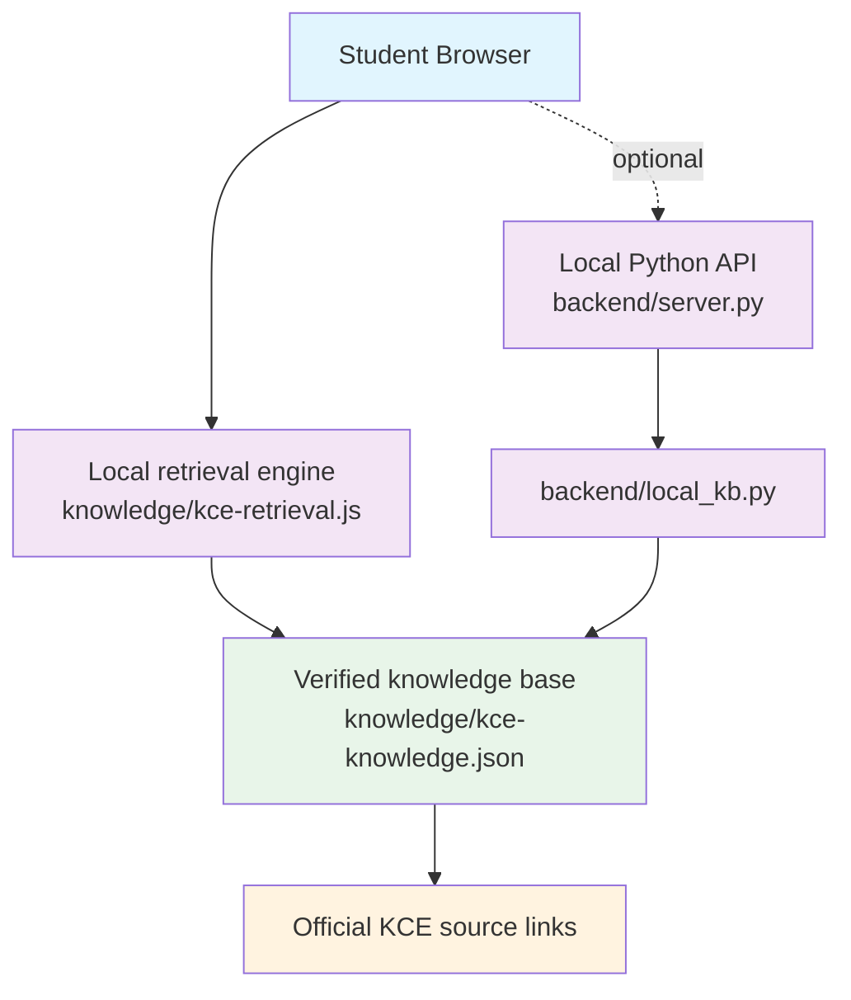

# KCE Campus AI — Architecture

## High-level architecture



No AWS services, credentials, databases, or paid AI APIs are involved.

## Request flow (default, browser-only)

1. **User interaction**: the student types a question.
2. **Normalisation**: `kce-retrieval.js` lowercases, strips punctuation, expands synonyms, and stems tokens.
3. **Scoring**: every knowledge-base entry is scored by keyword phrases, token overlap, and query coverage.
4. **Threshold**: the best match must meet a minimum score and coverage; otherwise the honest fallback is returned.
5. **Response**: the answer, official source links, and up to three follow-up questions are rendered in the chat.
6. **State cleanup**: the typing indicator is cleared in a `finally` block, so the UI cannot stay in a "Thinking…" state.

## Request flow (optional local API)

1. Set `API_ENDPOINT = "/api/chat"` in `script.js`.
2. `backend/server.py` receives `POST /api/chat`.
3. `backend/local_kb.py` loads `knowledge/kce-knowledge.json` and performs the same retrieval.
4. The server returns `{ answer, sources, followups, matched, source }`.
5. On timeout or failure the browser shows a clear error with **Try again**.

## Components

| Component | Purpose | Required |
| --- | --- | --- |
| `knowledge/kce-knowledge.json` | Canonical verified knowledge base | Yes |
| `knowledge/kce-knowledge.js` | Generated browser mirror | Yes (for `file://`) |
| `knowledge/kce-retrieval.js` | Deterministic retrieval engine | Yes |
| `knowledge/sync_knowledge.py` | Regenerate the JS mirror | For maintenance |
| `backend/local_kb.py` | Python retrieval engine | Only for the API |
| `backend/server.py` | Local static + JSON API server | Only for the API |
| `backend/lambda_function.py` | Lambda-compatible adapter | Optional |

## Data contract

```json
{
  "message": "What are the library hours?"
}
```

```json
{
  "answer": "**Library timings**\n…",
  "sources": [
    { "title": "Library", "url": "https://kingsengg.edu.in/library.html" }
  ],
  "followups": ["How many books can I borrow?"],
  "matched": "library",
  "source": "local"
}
```

When no entry matches confidently, `matched` is `null` and the answer states that the information cannot be verified locally.

## Design principles

- **Verified only**: no invented fees, dates, timetables, attendance rules, or statistics.
- **Honest fallback**: unknown questions point to official contact channels.
- **Local-first**: works offline from `file://` with no network requests.
- **No secrets**: nothing sensitive is stored in frontend code.
- **Graceful failure**: every request path clears the typing state and offers retry where appropriate.
